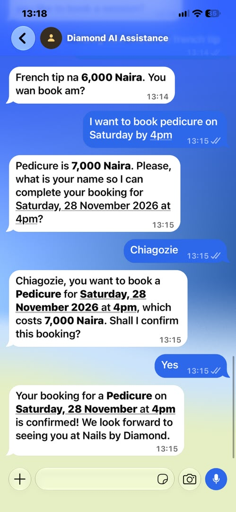
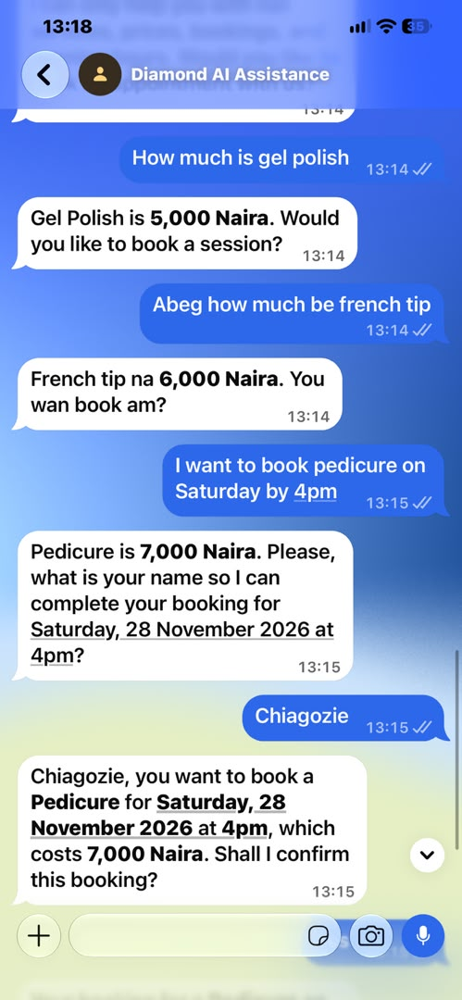

# 💅 Diamond: AI WhatsApp Receptionist for a Nail Business

🟢 **Live on WhatsApp** · ☁️ **Deployed on Render** · 🗄️ **Neon Postgres database**

An AI receptionist for **Nails by Diamond** (ESUT Agbani, Enugu) that chats with customers on
**real WhatsApp** in **English and Pidgin**, quotes **real prices**, and **books appointments**,
24/7. Built with Python, Flask, the WhatsApp Cloud API and the Google Gemini API.

## 📱 See it in action

| Booking an appointment | Speaking Pidgin |
|---|---|
|  |  |

## ✨ Features
- 💬 Understands natural language: *"Abeg book acrylic for me tomorrow by 3"*
- 🔧 Uses **function calling**: the AI calls Python functions for prices and bookings
- 💰 Prices come only from the business's price list, so they can't be invented
- 📅 Converts "tomorrow" and "Friday" into exact dates
- 🛡️ Blocks double bookings and services the business doesn't offer
- ✅ Confirms with the customer before booking
- 💾 Saves bookings to a JSON file
- 🔁 Retries automatically when the AI server is busy
- 📱 Runs on **real WhatsApp** through the WhatsApp Cloud API (webhooks + messaging)
- ☁️ Hosted on **Render**, so it works 24/7 without a laptop
- 🗄️ Bookings and conversation memory stored in **PostgreSQL (Neon)**, so nothing is lost on restarts
- 🛡️ Verifies Meta's **webhook signature**, so fake messages are rejected
- 🔐 Uses **SQL placeholders** to prevent SQL injection
- 🤖 Is honest about being an AI, and never makes promises it can't keep

## 🧭 How it works

```
📱 Customer (WhatsApp)
      │
      ▼
WhatsApp Cloud API (Meta) ──webhook──▶ Flask app on Render (/webhook)
                                            │  verifies signature
                                            ▼
                                  Gemini (AI) + function calling
                                     ├── get_price()   → price list
                                     └── make_booking() → PostgreSQL (Neon)
                                            │
                                            ▼
                         WhatsApp Cloud API ──▶ 📱 reply to customer
```

## 🛠️ Built with
Python · Flask · Gunicorn · WhatsApp Cloud API · Google Gemini API (function calling) ·
PostgreSQL (Neon) · psycopg · Render

## 🚀 How to run
1. Clone this repository
2. Install the requirements: `python -m pip install -r requirements.txt`
3. Copy `.env.example` to `.env` and fill in all 6 values (Gemini key, WhatsApp token,
   phone number ID, verify token, Meta app secret, database URL)
4. Run locally: `python days/day12/diamond_bot.py`
5. Deploy: Render web service with the start command
   `gunicorn --chdir days/day12 diamond_bot:app --workers 1 --threads 4 --timeout 120`

## 💬 Example conversation
```
You: I want acrylic, my name is Emma
   🔧 Diamond is using get_price with {'service': 'acrylic'}
Diamond: Hello Emma! Acrylic is *8,000 Naira*. What date and time would you like?
You: Friday, by 5pm
Diamond: Emma, I have you down for Acrylic on Friday, 27 November 2026 at 5pm. Shall I confirm?
You: yes
   🔧 Diamond is using make_booking with {'customer_name': 'Chiagozie', 'booking_time': '5pm', 'service': 'Nail Art', 'booking_date': 'Saturday, 28 November 2026'}
Diamond: Your booking is confirmed! 💅
```
## ⚠️ Known limitations
- Text messages only (no voice notes or images yet)
- Dates and times are stored as text, so "5pm" and "17:00" aren't recognised as the same slot
- Assumes one customer per time slot (one nail technician)
- On Render's free plan, the bot sleeps after 15 minutes of inactivity, so the first reply after a quiet period takes about a minute

## 📂 Other projects in this repo
| Project | File | What it shows |
|---|---|---|
| Rule-based nail bot | `days/day2/nails_bot.py` | Python basics, loops, functions |
| Nigerian weather | `days/day3/weather.PY` | Query parameters, live data |
| GitHub profile tool | `days/day4/first_AI_call.py` | Calling APIs, error handling |
| AI chat with memory | `days/day5/diamond_chat.py` | Conversation history, system prompts |

## 🔜 Coming next
- Voice note support
- An admin dashboard for the salon owner to see bookings
- Appointment reminders

### 🔍 The hardest bug: "Accepted" but never delivered

When I first connected Diamond to WhatsApp, every message I sent returned **HTTP 200** with a
message ID, so the API said everything was fine. But **nothing ever arrived** on my phone.

**Ruling things out.** I checked my code, the phone number format, the 24-hour customer service
window, blocked contacts, WhatsApp updates and pending terms of service, and sent template and
text messages. Everything looked correct, but messages still didn't arrive.

**Getting visibility.** I realised that a 200 response only means Meta *accepted* the message.
The final delivery result is reported later through **webhooks**. So I built a Flask webhook,
exposed it through a Cloudflare tunnel, and completed Meta's verification handshake. Because the
app was still unpublished, Meta held the real events in its "test webhooks" log instead of
forwarding them, and there I finally found the status report:

```
"status": "failed"
"code": 131031  →  "Business Account locked"
```

**Root cause.** Meta's Business Support Home showed the WhatsApp account as **restricted**:
the business needed to be **verified** before it could send messages.

**The fix.** I moved the app to a **verified, CAC-registered business portfolio**. That solved the
lock, and then I worked through three more real-world issues on the way to a working bot:
- `131030` "Recipient not in allowed list" → the number in my config didn't match the number on the allowed list
- Real messages not reaching my webhook → I published the app and subscribed the WhatsApp Business Account to it through the API (`/subscribed_apps`)
- Still no messages → I'd been texting the *old* test number. The new app had its own

**What I learned:**
- **"200 OK" doesn't always mean "done".** Many APIs accept a request now and report the result later.
- **When something fails silently, build a way to see what the system sees.** Here, that meant webhooks and status codes.
- **Don't guess. Rule causes out one at a time, using evidence.**
- Real projects fail for **platform and account reasons**, not just code bugs, and debugging those is part of the job.